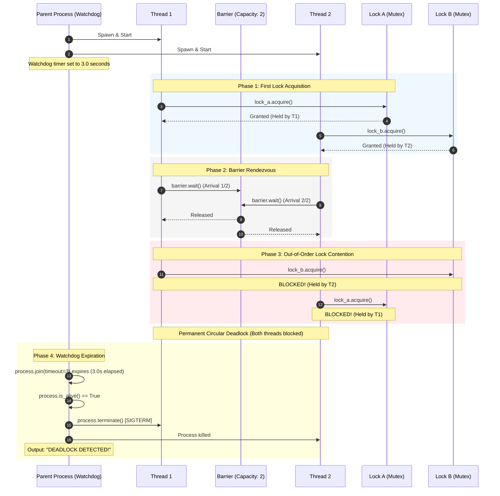
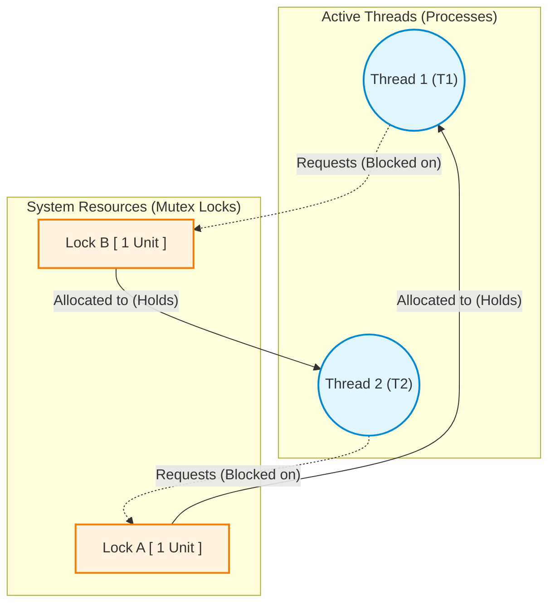
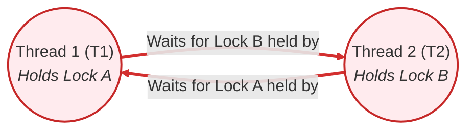

# CA-3 Phase 2: Root Cause Analysis (RCA)
## Diagnosis and Formal Modeling of the Two-Lock Deadlock

**Course:** Operating Systems  
**Component:** Continuous Assessment 3 (10 Marks) – OS Design & Debugging Challenge  
**Category:** Category D – Deadlock  
**Challenge:** Challenge D1 – Two-Lock Deadlock  
**Target Codebase:** `src/deadlock_demo.py`  
**Execution Environment:** Windows 11 (64-bit) | Python 3.14.7  
**Status:** Defect Successfully Reproduced & Diagnosed; No Code Modifications Applied  

---

## 1. Executive Summary

This document presents a comprehensive **Root Cause Analysis (RCA)** of the concurrency failure observed in `src/deadlock_demo.py`. The program demonstrates a classical synchronization defect: two concurrently executing threads compete for two shared binary mutual-exclusion locks (`lock_a` and `lock_b`) in reverse acquisition order.

Through deterministic synchronization enforced by a two-party rendezvous barrier (`threading.Barrier(2)`), the application reliably precipitates a fatal circular dependency. Neither thread can release its currently held lock before obtaining the second lock, causing both execution contexts to block permanently in operating system wait-queues. A parent watchdog process supervising the execution detects the liveness failure at a 3.0-second timeout and forcibly terminates the blocked subprocess.

This report establishes the execution interleaving, formalizes the lock ownership and waiting relationships, validates the simultaneous presence of all four Coffman conditions with direct source citations, models the deadlock via **Resource Allocation Graphs (RAG)** and **Wait-For Graphs (WFG)**, and analyzes why standard OS scheduling mechanisms cannot resolve this circular wait.

---

## 2. Code Inspection of `src/deadlock_demo.py`

An inspection of `src/deadlock_demo.py` (73 lines) reveals the exact architectural structure responsible for the deadlock:

```python
# Extracted from src/deadlock_demo.py
def reproduce_deadlock():
    lock_a = threading.Lock()
    lock_b = threading.Lock()
    barrier = threading.Barrier(2)

    def thread_1():
        print("Thread 1: Acquiring Lock A", flush=True)
        with lock_a:                                     # [1] T1 acquires Lock A
            print("Thread 1: Acquired Lock A", flush=True)
            barrier.wait()                               # [2] T1 rendezvous at Barrier
            print("Thread 1: Waiting for Lock B", flush=True)
            with lock_b:                                 # [3] T1 attempts to acquire Lock B
                print("Thread 1: Acquired Lock B", flush=True)

    def thread_2():
        print("Thread 2: Acquiring Lock B", flush=True)
        with lock_b:                                     # [4] T2 acquires Lock B
            print("Thread 2: Acquired Lock B", flush=True)
            barrier.wait()                               # [5] T2 rendezvous at Barrier
            print("Thread 2: Waiting for Lock A", flush=True)
            with lock_a:                                 # [6] T2 attempts to acquire Lock A
                print("Thread 2: Acquired Lock A", flush=True)
```

### Key Architectural Components

1. **Shared Mutual Exclusion Locks (`lock_a`, `lock_b`):**
   - Instantiated as `threading.Lock()`, which wraps native OS synchronization primitives (e.g., Windows `SRWLock` / CriticalSection or POSIX `pthread_mutex_t`).
   - These are **non-reentrant binary locks** with capacity $C = 1$. They provide exclusive ownership to exactly one thread at a time.
2. **Synchronization Barrier (`threading.Barrier(2)`):**
   - The barrier requires exactly two threads to call `barrier.wait()` before either is permitted to proceed past the synchronization point.
   - **Critical Role:** In unsynchronized multithreaded programs, deadlocks are notoriously non-deterministic ("heisenbugs") because one thread might acquire both locks and exit before the other thread even starts. The barrier eliminates race nondeterminism by forcing $T_1$ to hold Lock A and $T_2$ to hold Lock B *prior* to either attempting the second acquisition.
3. **Inverted Lock Ordering:**
   - Thread 1 follows acquisition order: $\mathcal{O}_1 = \langle \text{Lock A}, \text{Lock B} \rangle$.
   - Thread 2 follows acquisition order: $\mathcal{O}_2 = \langle \text{Lock B}, \text{Lock A} \rangle$.
   - The asymmetry $\mathcal{O}_1 \ne \mathcal{O}_2$ directly introduces the circular dependency.
4. **Supervisory Process (`multiprocessing.Process`):**
   - Runs `reproduce_deadlock` in an isolated operating system process.
   - Calls `process.join(timeout=3)` on line 56, acting as an external watchdog timer.
   - If the child process is still alive after 3.0 seconds, it confirms a deadlock and calls `process.terminate()`.

---

## 3. Thread Execution Sequence & Concurrency Interleaving

The table below details the step-by-step interleaving across physical timeline $t_0 \to t_{\text{deadlock}}$:

| Step | Time / Sequence | Thread 1 ($T_1$) | Thread 2 ($T_2$) | Lock A State | Lock B State | Barrier State |
| :---: | :---: | :--- | :--- | :---: | :---: | :---: |
| 1 | $t_0$ | Spawned by Main Process | Spawned by Main Process | Free | Free | Count = 0 / 2 |
| 2 | $t_1$ | `print("Acquiring Lock A")` | `print("Acquiring Lock B")` | Free | Free | Count = 0 / 2 |
| 3 | $t_2$ | **Acquires Lock A** (`with lock_a:`) | **Acquires Lock B** (`with lock_b:`) | **Held by $T_1$** | **Held by $T_2$** | Count = 0 / 2 |
| 4 | $t_3$ | `print("Acquired Lock A")` | `print("Acquired Lock B")` | Held by $T_1$ | Held by $T_2$ | Count = 0 / 2 |
| 5 | $t_4$ | Calls `barrier.wait()` (blocks) | Calls `barrier.wait()` (trips barrier) | Held by $T_1$ | Held by $T_2$ | **Count = 2 / 2 (Tripped)** |
| 6 | $t_5$ | Released from barrier | Released from barrier | Held by $T_1$ | Held by $T_2$ | Reset |
| 7 | $t_6$ | `print("Waiting for Lock B")` | `print("Waiting for Lock A")` | Held by $T_1$ | Held by $T_2$ | Reset |
| 8 | $t_7$ | **Requests Lock B** (`with lock_b:`) | **Requests Lock A** (`with lock_a:`) | Held by $T_1$ | Held by $T_2$ | Reset |
| 9 | $t_8$ | **Kernel blocks $T_1$** on Lock B wait-queue | **Kernel blocks $T_2$** on Lock A wait-queue | Held by $T_1$ | Held by $T_2$ | Reset |
| 10 | $t > t_8$ | **BLOCKED (Indefinite Wait)** | **BLOCKED (Indefinite Wait)** | **DEADLOCK** | **DEADLOCK** | — |

### Sequence Diagram



---

## 4. Lock Ownership and Waiting Relationships

At the point of synchronization failure ($t \ge t_8$), the system state is formally characterized by the following resource ownership and request matrices:

### Resource State Matrix

| Resource Entity | Total Capacity | Available Units | Current Owner | Requesting Threads (Blocked Queue) |
| :---: | :---: | :---: | :---: | :---: |
| **Lock A** | 1 | 0 | **Thread 1 ($T_1$)** | Thread 2 ($T_2$) |
| **Lock B** | 1 | 0 | **Thread 2 ($T_2$)** | Thread 1 ($T_1$) |

### Thread State Matrix

| Thread Entity | Execution State | OS Scheduling State | Resources Held (Allocated) | Resources Requested (Blocked On) |
| :---: | :---: | :---: | :---: | :---: |
| **Thread 1 ($T_1$)** | Blocked | `WAITING` / `BLOCKED` | $\{\text{Lock A}\}$ | $\{\text{Lock B}\}$ |
| **Thread 2 ($T_2$)** | Blocked | `WAITING` / `BLOCKED` | $\{\text{Lock B}\}$ | $\{\text{Lock A}\}$ |

### Formal Graph Edges
- **Assignment Edges ($R \to T$):**
  - $e_1 = (\text{Lock A}, T_1)$ — Lock A is allocated to and held by Thread 1.
  - $e_2 = (\text{Lock B}, T_2)$ — Lock B is allocated to and held by Thread 2.
- **Request Edges ($T \to R$):**
  - $e_3 = (T_1, \text{Lock B})$ — Thread 1 is blocked waiting for Lock B.
  - $e_4 = (T_2, \text{Lock A})$ — Thread 2 is blocked waiting for Lock A.

---

## 5. Coffman Conditions Analysis with Source Code Evidence

In classical operating systems theory (Coffman, Elphick, and Shoshani, 1971), a deadlock can arise if and only if **all four** of the following conditions hold concurrently. The table below maps each condition directly to its programmatic manifestation in `src/deadlock_demo.py`:

| # | Coffman Condition | Theoretical Definition | Programmatic Manifestation in `deadlock_demo.py` | Line Citations |
| :---: | :--- | :--- | :--- | :---: |
| **1** | **Mutual Exclusion** | Resources are non-shareable; at most one thread can hold a resource instance at any time. | `lock_a = threading.Lock()` and `lock_b = threading.Lock()` create binary mutexes. In Python, a `Lock` object enforces that once a thread acquires it via `with lock_a:`, any subsequent `acquire()` call by another thread must wait until it is explicitly released. Concurrent access is strictly prohibited. | Lines 7–8, 15, 28 |
| **2** | **Hold and Wait** | A thread holds at least one resource while concurrently waiting to acquire additional resources held by other threads. | Thread 1 enters `with lock_a:` (line 15, **holding** Lock A) and, without releasing Lock A, executes `with lock_b:` (line 22, **waiting** for Lock B). Symmetrically, Thread 2 enters `with lock_b:` (line 28, **holding** Lock B) and executes `with lock_a:` (line 35, **waiting** for Lock A). Neither thread relinquishes its initial allocation before requesting the second lock. | Lines 15–22, 28–35 |
| **3** | **No Preemption** | Resources cannot be forcibly seized from a holding thread; a resource is released only voluntarily by the thread holding it upon completing its critical task. | In Python's threading library and host OS threading APIs, mutexes are non-preemptible. Neither the runtime nor the OS scheduler can forcibly revoke ownership of Lock A from Thread 1 or Lock B from Thread 2. Locks are released exclusively via the `__exit__()` method of the `with` block, which is structurally unreachable while the thread is blocked. | Lines 15, 22, 28, 35 |
| **4** | **Circular Wait** | A closed directed chain of threads $\{T_1, T_2, \dots, T_k\}$ exists such that $T_1$ waits for a resource held by $T_2$, and $T_k$ waits for a resource held by $T_1$. | Thread 1 waits for Lock B, which is held by Thread 2. Thread 2 waits for Lock A, which is held by Thread 1. This establishes the closed cycle: $T_1 \to \text{Lock B} \to T_2 \to \text{Lock A} \to T_1$. | Lines 22, 35 |

> **Diagnostic Finding:** Because all four conditions are satisfied simultaneously without any evasion mechanism, the system inevitably enters a permanent deadlock state upon tripping the barrier.

---

## 6. Formal Graph-Theoretic Modeling

### A. Resource Allocation Graph (RAG)

A **Resource Allocation Graph** is a directed bipartite graph $G = (V, E)$ where:
- Vertices $V = P \cup R$:
  - $P = \{T_1, T_2\}$ represents the set of active processes/threads (drawn as circles).
  - $R = \{\text{Lock A}, \text{Lock B}\}$ represents the set of resource types (drawn as rectangles containing 1 unit each).
- Edges $E = E_{\text{assignment}} \cup E_{\text{request}}$:
  - Assignment edges ($R_j \to T_i$): indicate that an instance of resource $R_j$ has been allocated to thread $T_i$.
  - Request edges ($T_i \to R_j$): indicate that thread $T_i$ has requested an instance of resource $R_j$ and is currently waiting.



#### Graph Property: Cycle Sufficiency Theorem
In general multi-instance resource systems, a cycle in a Resource Allocation Graph is a *necessary* but not *sufficient* condition for deadlock. However, **in systems where every resource type has exactly one instance** ($C(R_j) = 1$ for all $j$):

$$\text{Cycle in RAG} \iff \text{Deadlock}$$

Since both `lock_a` and `lock_b` are strictly single-instance binary mutexes ($C = 1$), the cycle:
$$\mathcal{C} = \langle T_1, \text{Lock B}, T_2, \text{Lock A}, T_1 \rangle$$
constitutes **formal mathematical proof** of an unresolvable deadlock.

---

### B. Wait-For Graph (WFG)

When all resource types are single-instance, the Resource Allocation Graph can be reduced directly into a **Wait-For Graph (WFG)** by contracting all resource nodes. 

A Wait-For Graph is a directed graph $G_{\text{wfg}} = (P, E_{\text{wait}})$ where:
- Vertices $P = \{T_1, T_2\}$ are active threads.
- A directed edge $(T_i \to T_j) \in E_{\text{wait}}$ exists if and only if thread $T_i$ is waiting for a resource that is currently allocated to thread $T_j$.



#### Graph Reduction Derivation
1. Edge $(T_1, \text{Lock B}) \in E_{\text{request}}$ and $(\text{Lock B}, T_2) \in E_{\text{assignment}} \implies (T_1 \to T_2) \in E_{\text{wait}}$.
2. Edge $(T_2, \text{Lock A}) \in E_{\text{request}}$ and $(\text{Lock A}, T_1) \in E_{\text{assignment}} \implies (T_2 \to T_1) \in E_{\text{wait}}$.
3. The resulting edge set is $E_{\text{wait}} = \{(T_1, T_2), (T_2, T_1)\}$.
4. This forms the closed simple 2-cycle:
   $$T_1 \leftrightarrows T_2$$
   The adjacency matrix of the Wait-For Graph is:
   $$A = \begin{pmatrix} 0 & 1 \\ 1 & 0 \end{pmatrix}$$
   Because $\text{trace}(A^2) = 2 > 0$, the graph contains a closed cycle of length 2, verifying the deadlock.

---

### C. Visual Artifacts in Repository

High-resolution, publication-grade diagram files have been generated and archived in [`CA3-Two-Lock-Deadlock/diagrams/`](file:///c:/Users/Vanshika/Downloads/Academics/OS%20cloned/Operating-System-Concepts/CA3-Two-Lock-Deadlock/diagrams/):
- **[deadlock_graphs.png](file:///c:/Users/Vanshika/Downloads/Academics/OS%20cloned/Operating-System-Concepts/CA3-Two-Lock-Deadlock/diagrams/deadlock_graphs.png):** Combined side-by-side visualization of RAG and WFG (300 DPI).
- **[resource_allocation_graph.png](file:///c:/Users/Vanshika/Downloads/Academics/OS%20cloned/Operating-System-Concepts/CA3-Two-Lock-Deadlock/diagrams/resource_allocation_graph.png):** Standalone publication figure of the Resource Allocation Graph.
- **[wait_for_graph.png](file:///c:/Users/Vanshika/Downloads/Academics/OS%20cloned/Operating-System-Concepts/CA3-Two-Lock-Deadlock/diagrams/wait_for_graph.png):** Standalone publication figure of the Wait-For Graph.
- **[resource_allocation_graph.mmd](file:///c:/Users/Vanshika/Downloads/Academics/OS%20cloned/Operating-System-Concepts/CA3-Two-Lock-Deadlock/diagrams/resource_allocation_graph.mmd):** Raw Mermaid source for RAG.
- **[wait_for_graph.mmd](file:///c:/Users/Vanshika/Downloads/Academics/OS%20cloned/Operating-System-Concepts/CA3-Two-Lock-Deadlock/diagrams/wait_for_graph.mmd):** Raw Mermaid source for WFG.
- **[thread_execution_trace.mmd](file:///c:/Users/Vanshika/Downloads/Academics/OS%20cloned/Operating-System-Concepts/CA3-Two-Lock-Deadlock/diagrams/thread_execution_trace.mmd):** Raw Mermaid sequence diagram of the execution trace.
- **[generate_diagrams.py](file:///c:/Users/Vanshika/Downloads/Academics/OS%20cloned/Operating-System-Concepts/CA3-Two-Lock-Deadlock/diagrams/generate_diagrams.py):** Reproducible script for rendering diagram graphics.

---

## 7. Mechanism of Indefinite Liveness Failure

A critical question in operating systems debugging is: **Why does the circular wait prevent the threads from ever recovering on their own?**

### The Operating System Scheduling Perspective
1. **Thread State Transition to BLOCKED:**
   - When Thread 1 calls `lock_b.acquire()` on line 22, the underlying CPython implementation invokes the OS kernel synchronization primitive (e.g., `WaitForSingleObject` / `EnterCriticalSection` on Windows or `pthread_mutex_lock` via `futex` on Linux).
   - Because Lock B is already held by Thread 2, the lock's internal state reflects ownership by $T_2$.
   - The OS kernel thread scheduler removes Thread 1 from the CPU **Ready Queue** and places it into the **Mutex Wait Queue** associated with Lock B. Thread 1's state becomes `WAITING` / `BLOCKED`.
   - In this state, Thread 1 consumes **0% CPU** and cannot execute any further machine instructions.
2. **Symmetric Blocking of Thread 2:**
   - Symmetrically, Thread 2 calls `lock_a.acquire()` on line 35.
   - The OS kernel scheduler removes Thread 2 from the Ready Queue and places it into Lock A's Mutex Wait Queue.
   - Thread 2 enters the `WAITING` / `BLOCKED` state, consuming 0% CPU.
3. **The Unbreakable Wake-Up Dependency:**
   - The *only* mechanism by which Thread 1 can transition back from `BLOCKED` to `READY` is if another thread executes `lock_b.release()`.
   - In Python, `lock_b.release()` is only called when Thread 2 exits the context manager `with lock_b:` (line 29).
   - However, for Thread 2 to exit `with lock_b:`, it must execute lines 33–37, which requires completing `with lock_a:`.
   - Thread 2 cannot execute `with lock_a:` because it is blocked waiting for `lock_a.release()`, which can only be executed when Thread 1 exits `with lock_a:` (line 16).
   - Thread 1 cannot exit `with lock_a:` because it is blocked waiting for `lock_b.release()`.
4. **Conclusion:**
   - The wake-up trigger for each thread is conditioned on the forward progress of the other thread.
   - Because neither thread can make forward progress while blocked in kernel mutex wait-queues, **neither wake-up event will ever be posted**.
   - Without an external preemption event, timeout mechanism, or process supervisor, the threads would remain dormant in the kernel mutex wait-queue permanently.

---

## 8. Empirical Baseline Execution & Watchdog Supervision

### Observed Terminal Execution Transcript
Executing `src/deadlock_demo.py` under Python 3.14 on Windows produces the following verbatim console output:

```text
Thread 1: Acquiring Lock A
Thread 1: Acquired Lock A
Thread 2: Acquiring Lock B
Thread 2: Acquired Lock B
Thread 2: Waiting for Lock A
Thread 1: Waiting for Lock B
Starting Two-Lock Deadlock Demonstration

[... Exactly 3.00 seconds of execution pause ...]

DEADLOCK DETECTED!
Both threads are waiting for each other's locks.
Deadlocked process safely terminated.
```

### Analysis of the Supervisor Architecture
In standard multithreaded Python programming, deadlocks cannot be handled within the same process:
- Python threads cannot be killed or interrupted asynchronously from another thread. There is no `thread.terminate()` or `thread.stop()` in Python's standard library (unlike Java's deprecated `Thread.stop()`), because forcibly tearing down a thread holding shared memory locks would leave the interpreter's internal heap and GIL in a corrupt state.
- If `reproduce_deadlock()` were executed directly on the main thread, the entire Python process would hang indefinitely, requiring manual OS-level termination (`taskkill` / `kill -9`).

The implementation in `deadlock_demo.py` addresses this through **Process-Level Watchdog Supervision**:
1. `process = multiprocessing.Process(target=reproduce_deadlock)` spawns a dedicated child OS process.
2. `process.join(timeout=3)` blocks the parent process for a maximum of 3.0 seconds.
3. If the threads finish normally within 3 seconds, `process.is_alive()` returns `False`.
4. Because the child process deadlocks, the 3.0-second timeout elapses with `process.is_alive() == True`.
5. The parent process safely invokes `process.terminate()` (which calls `TerminateProcess` on Windows or sends `SIGTERM` on POSIX), reclaiming all allocated memory and OS handles cleanly without hanging the test environment.

---

## 9. Diagnostic Verdict & Roadmap to Phase 3

### Root Cause Statement
> **"The concurrency failure in `src/deadlock_demo.py` is caused by asymmetric lock acquisition ordering ($\mathcal{O}_1 = \langle A, B \rangle$ vs $\mathcal{O}_2 = \langle B, A \rangle$) between two concurrently executing threads holding non-preemptible binary locks, which establishes a cyclic wait condition $T_1 \to \text{Lock B} \to T_2 \to \text{Lock A} \to T_1$ and results in mutual indefinite blocking."**

### Strategic Roadmap for Phase 3 (Solution Design & Alternatives)
Per the CA-3 requirements, Phase 3 will propose and evaluate at least two distinct engineering solutions to eliminate the deadlock:

1. **Strategy 1: Global Resource Ordering (Prevention – Breaking Circular Wait):**
   - Enforce a strict global hierarchy $\mathcal{H}: \text{Lock A} < \text{Lock B}$.
   - Every thread must acquire Lock A *before* acquiring Lock B.
   - This mathematically precludes the formation of a directed cycle in the Wait-For Graph (Havender, 1968).
2. **Strategy 2: Non-Blocking Acquisition with Backoff / Timeout (Prevention – Breaking Hold-and-Wait):**
   - Use `lock.acquire(timeout=...)` or `acquire(blocking=False)`.
   - If the second lock cannot be acquired within a threshold, the thread releases its already-acquired first lock, backs off for a randomized interval, and retries.
   - Eliminates the indefinite "Hold and Wait" condition.

---

## 10. References

1. Coffman, E. G., Elphick, M., & Shoshani, A. (1971). *System Deadlocks*. ACM Computing Surveys (CSUR), 3(2), 67–78.
2. Silberschatz, A., Galvin, P. B., & Gagne, G. (2018). *Operating System Concepts* (10th ed.). John Wiley & Sons. Chapter 8: Deadlocks.
3. Havender, J. W. (1968). *Avoiding Deadlock in Multitasking Systems*. IBM Systems Journal, 7(2), 74–84.
4. Tanenbaum, A. S., & Bos, H. (2015). *Modern Operating Systems* (4th ed.). Pearson. Chapter 6: Deadlocks.
